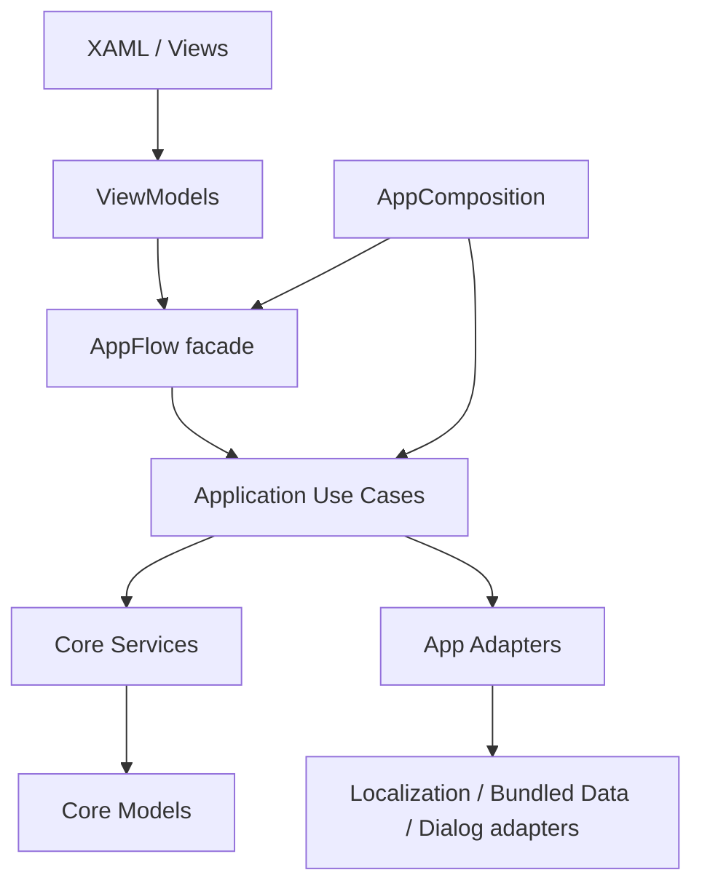
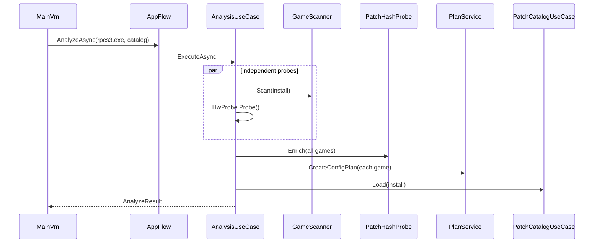

# دليل المطور الكامل

## 1. ما هو R3Config؟

R3Config تطبيق WPF محلي يعمل كمساعد لـ RPCS3. يكتشف التثبيت والألعاب، يقرأ
التوصيات والكتالوجات، يطابق الباتشات مع serial/version/hash، ثم يسمح للمستخدم
بتغييرات محددة وقابلة للتراجع.

هو ليس جزءًا من emulator runtime. لا ينفذ PPU/SPU ولا يرسم RSX ولا يعدل firmware
أو game payload. علاقته بالمحاكي هي ملفات metadata/config/patch المعروفة فقط.

## 2. الهيكل النهائي

```text
R3Config/
├─ Core/
│  ├─ Mdl/                         domain records and enums
│  └─ Svc/
│     ├─ Scan/                     install, games.yml, PARAM.SFO
│     ├─ Cfg/                      config plan, YAML, apply/remove
│     ├─ Patch/                    parse, merge, match, compile, transaction
│     ├─ Bkp/                      backup manifests and restore
│     └─ Mutation/Guard.cs         process + target boundary
├─ App/
│  ├─ Application/                 use cases and application contracts
│  ├─ Composition/AppComposition.cs single composition root
│  ├─ Flow.cs                      compatibility facade only
│  ├─ Vm/                          presentation state and commands
│  ├─ View/, Ctrl/                 WPF views and small code-behind
│  ├─ Svc/                         UI/application adapters and bundled gateways
│  ├─ Lang/                        ar-SA/en-US resources
│  └─ Data/                        shipped catalogs
├─ Tst/                            executable smoke/regression harness
├─ Script/                         source/release/portable gates
└─ docs/Arch/                      this architecture pack
```

### اتجاه الاعتماديات



الممنوع هو السهم العكسي: Core لا يعرف App، وApplication لا يعرف WPF/ViewModel،
والـ ViewModel لا يعرف تفاصيل YAML أو atomic transaction.

## 3. Composition Root وعمر الخدمات

`App/Composition/AppComposition.cs` هو المكان الوحيد الذي يبني graph التشغيل.
ينشئ ويشارك:

- `BackupService` واحدًا بين config/patch/H-Canary workflows؛
- `Rpcs3MutationGuard` واحدًا لكل use cases المعدلة؛
- `PatchCatalogReader` و`PatchConfigReader` المشتركين؛
- `PatchFileTransactionService` موصولًا بنفس backup/readers؛
- `HCanaryPatchAuthoringService` موصولًا بالمعاملة نفسها؛
- جميع use cases داخل `AppUseCases`؛
- `AppFlow` الذي يفوض لها؛
- خدمات runtime البسيطة التي يحتاجها `MainVm`.

لا يوجد DI container خارجي. constructor injection هو القاعدة، وComposition Root
هو الـ manual container. إضافة `new SomeDomainService()` داخل ViewModel أو command
تعتبر كسرًا معماريًا.

## 4. AppFlow

`App/Flow.cs` موجود للتوافق مع bindings والاختبارات والكود القديم. كل method فيه
يجب أن يكون delegate قصيرًا إلى use case. لا parsing ولا loops على catalog ولا
filesystem logic ولا policy جديدة داخله.

إذا أضفت use case:

1. أضفه إلى `AppUseCases`.
2. أنشئه في `AppComposition`.
3. أضف delegate في `AppFlow` فقط إذا احتاجت الواجهة الحالية واجهة التوافق.
4. استدع delegate من ViewModel.

## 5. Use Cases

| Use case | الوظيفة | قراءة/تعديل |
|---|---|---|
| `AnalysisUseCase` | التثبيت، hardware، scan، hash enrichment، الخطط | قراءة |
| `ConfigUseCase` | بناء plan وتطبيق/إزالة التغييرات | مختلط؛ apply/remove محروس |
| `PatchCatalogUseCase` | تحميل المصادر ودمجها وبناء preview | قراءة |
| `PatchMutationUseCase` | enable/disable plans وتجهيز Canary/Cheats والتطبيق | مختلط؛ mutations محروسة |
| `CanaryImportUseCase` | normalize ثم manual import | normalize قراءة؛ import محروس |
| `RecommendationCatalogUseCase` | built-in catalog، rebuild، info، export | قراءة؛ export لمسار يختاره المستخدم |
| `BackupUseCase` | list/restore | list قراءة؛ restore محروس |
| `HCanaryUseCase` | load/save/delete authored patches | load قراءة؛ save/delete محروسان |

Application use case يجوز له تنسيق أكثر من خدمة، لكنه لا يعرض dialog ولا يترجم
رسالة. `IPatchCatalogMessageFormatter` مثال adapter مقلوب: الـ use case يطلب عقدًا،
و`LocalizedPatchCatalogMessageFormatter` في App/Svc ينفذ الترجمة.

## 6. ViewModels بعد التقسيم

### MainVm

`MainVm` partial واحد موزع حسب المسؤولية:

| الملف | المسؤولية |
|---|---|
| `Main.cs` | fields، properties، commands، wiring، constructor injection |
| `Main.Shell.cs` | shell actions، اللغة، اختيار RPCS3، التحليل، Canary dialog |
| `Main.Config.cs` | apply/remove config وبناء الخطة الحالية |
| `Main.Patches.cs` | preview، enable/disable، patch warnings وcommand policy |
| `Main.Advanced.cs` | restore، backups، catalog developer tools، diagnostics |
| `Main.Presentation.cs` | localization refresh، status formatting، UI summaries |

لا تنقل method إلى ملف عشوائي. إذا صار الجزء فوق 500 سطر أو جمع مسؤوليتين، أنشئ
partial جديدًا باسم المسؤولية أو استخرج ViewModel/adapter مستقلًا.

### HCanaryVm

| الملف | المسؤولية |
|---|---|
| `HCan.cs` | child models، state، properties، commands، injected flow |
| `HCan.Context.cs` | install/game context واللغة |
| `HCan.Editor.cs` | draft editing، validation، YAML preview |
| `HCan.Evidence.cs` | log/hash evidence وstored patch loading |
| `HCan.Persistence.cs` | save/delete/open actions وحراس UI |

الحفظ والحذف يمران عبر `HCanaryUseCase`; خدمة authoring داخل ViewModel تستخدم فقط
للـ validation/generation المحلي ولا تكتب.

## 7. دورة التحليل



هذا المسار read-only. لا ينشئ config أو patch files ولا يختار توصية أو باتشًا.
فشل مصدر catalog مستقل لا يلغي المصادر الصالحة؛ النتيجة تحمل diagnostic.

## 8. دورة config

1. `PlanService` يقارن current config مع recommendation وhardware.
2. `ConfigPlan` يحمل current/proposed/state/risk/actionability.
3. المستخدم يختار actionable items ويؤكد.
4. `ConfigUseCase` يثبت أن target يساوي
   `custom_configs/config_<SERIAL>.yml` الخاص بالـ install.
5. `IRpcs3MutationGuard` يفحص descriptor والمسار وتشغيل RPCS3.
6. `ConfigApplyService` ينشئ backup ثم يطبق YAML atomically.
7. عند الفشل يستعيد backup؛ وعند نجاح UI يعيد الخطة من القرص.

الإزالة تزيل paths التي تمثلها `ConfigChange` فقط، ولا تحذف custom config كله.

## 9. دورة patch

### المصادر

| المصدر | النوع | الملكية |
|---|---|---|
| `patch.yml` | Official resident | RPCS3؛ قراءة فقط |
| `imported_patch.yml` | Imported resident | مشترك؛ تعديل محافظ ومعاملة |
| `<TITLE_ID>_patch.yml` | Title-specific resident loaded at boot | قراءة؛ R3Config يكتب cheats فقط مع managed marker ويرفض ملف مستخدم غير معلّم |
| `can.yml` | Bundled Canary preview | بيانات مشحونة؛ لا تُنسخ إلا للمختار |
| `cheats.yml` | Bundled Cheats preview | third-party catalog مع provenance |
| `r3cht.yml` | Managed migration library | يكتب داخل المعاملة؛ RPCS3 لا يحمّله عند إقلاع اللعبة |
| `r3config_cheats_patch.yml` | Legacy migration input | قراءة للترحيل فقط ولا يُحذف تلقائيًا |

`PatchCatResult.SourceStatuses` هو مصدر تشخيص الواجهة لكل ملف على حدة. كل حالة
تحتفظ بالاسم والمسار والملكية والوجود ونجاح القراءة وعدد الإدخالات ورسالة الخطأ.
غياب `patch.yml` لا يعني أن Canary تالف، ونجاح Canary لا يعني أن الكتالوج الرسمي
محمّل. يجب ألا تختزل الواجهة كل هذه الحالات في عدد merged واحد.

تنزيل `patch.yml` ملك لـ RPCS3: المستخدم يفتح `Manage > Game Patches`، فيفحص
Patch Manager التحديث ويقارن SHA-256 ويحلل المحتوى قبل أن يكتب الملف. لا توجد في
الإصدار الحالي واجهة CLI لفتح المدير مباشرة؛ لذلك R3Config يشغّل المحاكي ويعرض
المسار الدقيق ثم يعيد قراءة الملف بعد اختيار المستخدم «إعادة التحليل». لا ينفذ
R3Config طلب الشبكة ولا يكتب `patch.yml` نيابة عن المحاكي.

قاعدة `can.yml` الحالية مطبّعة من لقطة `Help_Game Patches_Canary - RPCS3 Wiki`
المرفقة. فحص المصدر يثبت احتفاظها بكل مفاتيح البصمات التنفيذية الـ86 الموجودة في
اللقطة؛ أي تحديث مستقبلي للقاعدة يعيد مقارنة مجموعة المفاتيح ثم parser/count tests
ولا يعتمد على اسم الملف أو تاريخ اللقطة وحده.

### pipeline

```text
Read each source
 -> parse valid entries + diagnostics
 -> merge by HashKind|Hash|Title
 -> match against serial/version/all detected hashes
 -> show every relevant result, select none by default
 -> user selects
 -> planner keeps ExactMatch or RPCS3-runtime-guarded matches only
 -> compiler prepares selected definitions/dependencies
 -> guard all targets
 -> one backup manifest
 -> one atomic multi-file transaction
 -> reload catalog and patch_config from disk
```

resident definition يتقدم على bundled preview. نسخة رقمية أعلى قد تتقدم بين
مصادر من الرتبة نفسها. تعريفان مختلفان بالهوية والنسخة نفسها يُرفضان.

Enable يحتاج `ExactMatch`، أو trusted definition ذات serial/version مطابقين
ومفتاح hash صالح مع غياب الدليل المحلي فقط. الحالة الثانية تبقى
`SerialVersionMatchHashUnknown` لكن `PatchActivationPolicy` يسمح بها لأن RPCS3
يحسب hash وقت الإقلاع ويبحث عن ذلك المفتاح قبل التطبيق. بصمة PPU الرئيسية
الموثوقة المخالفة محظورة؛ أما cache القديم أو SPU/PRX/OVL غير المشاهد فهي أدلة
جزئية ويحسمها RPCS3 وقت تحميل الوحدة. Disable يسمح أيضًا بالحالة نفسها لأنه
يزيل enabled state. Expert mode لا يتجاوز الشرط.

طبقة القرار الرسمية هي `PatchCompatibilityService`. تجمع السيريال والإصدار
وأدلة PPU/SPU/PRX/OVL وتنتج `PatchCompatibilityDecision` واحدًا تستخدمه كل
المصادر. راجع [عقد التوافق الكامل](PatCmp.md) قبل تغيير matcher أو
parser أو compiler أو واجهة الباتشات.

## 10. Hash evidence

`Rpcs3GameDescriptor` يحتفظ بكل PPU/SPU/PRX/OVL hashes، مع
source/message/kind/timestamp.
المصادر الحالية: metadata، log، gzip log، وbounded per-game cache. probing محدود
بالحجم والتمدد وعدد entries.

قراءة `RPCS3.log` الكبير لا تعتمد على آخر السجل فقط. القارئ يأخذ head وtail ضمن
حد ثابت، ويفحص tail أولاً لأنه الأحدث، ثم head حتى لا تضيع جلسة الإقلاع إذا تجاوز
السجل 16 MiB. يبقى الجزآن منفصلين كي لا تُنسب بصمة من tail إلى `SYS: Serial`
موجود في head عبر منطقة وسطى لم تُقرأ. ويطبق gzip الفكرة نفسها مع حدود مستقلة
لحجم الملف المضغوط والبيانات المفكوكة. أي تغيير هنا يجب أن يختبر سجلًا أكبر من
الحد وفيه serial/hash صالحان قرب البداية، للنص العادي وgzip.

الإصدار الظاهر في تعريف الباتش هو **هدف** وليس إعلان توافق. `ExactMatch` ينتج
عند تطابق serial + version + runtime module key. PPU/SPU/OVL تستخدم 40-hex،
وPRX يستخدم Base57 مع segment. اختلاف الإصدار يبقى `VersionMismatch`، وتعارض
بصمة PPU الرئيسية الموثوقة يبقى `HashMismatch` ولا يقبل التفعيل.

عند تطابق serial/version وغياب البصمة محليًا تبقى النتيجة
`SerialVersionMatchHashUnknown`. يمكن تفعيلها فقط إذا كان المصدر معروفًا، ومفتاح
PPU/SPU/PRX/OVL صالحًا، والهدف ليس `All` الغامض. هذا لا يطبق الباتش تخمينًا:
RPCS3 ينشئ اسم PPU/SPU/PRX/OVL من hash الفعلي وقت التشغيل، ثم لا يدخل patch block
إلا إذا وجد الاسم نفسه، وبعدها يعيد فحص serial/version وEnabled.

## 11. Mutation Guard

`Core/Svc/Mut/Rpcs3MutationGuard.cs` هو الحاجز المركزي. يفحص:

- descriptor: exe اسمه `rpcs3.exe` وبقية المسارات داخل root الصحيح؛
- كل target مصرح به وتحت `config/` أو `patches/`؛
- لا target فارغ أو مكرر؛
- لا توجد عملية `rpcs3` مشغلة.

ViewModel يفحص التشغيل أيضًا لتقديم warning مترجم مبكر، لكنه ليس مصدر الأمان.
المصدر النهائي هو use case الذي يستدعي guard قبل أول side effect. Patch mutation
يعيد الفحص بعد تجهيز الملفات وقبل commit.

الحارس خاص بملفات RPCS3. حفظ App preferences أو export لمسار اختاره المستخدم
لهما عقد مختلف ولا يمران به.

## 12. Backup وtransaction

`BackupService` يسجل `Existed` لكل target. إذا لم يكن الملف موجودًا ثم فشلت
المعاملة، restore يحذف الملف الذي أنشئ. اسم النسخة مبني من SHA-256 لمسار target.

`PatchFileTransactionService`:

1. يطبّع ويرفض الأهداف المكررة.
2. يكتب stage بجانب كل target.
3. يتحقق من read-back ومن YAML/JSON/entry count.
4. يأخذ manifest واحدًا لكل الأهداف.
5. يستخدم replace/move.
6. يستعيد الجميع إذا فشل target واحد.
7. يحذف stages في finally.

لا تنفذ عمليتين متتاليتين لتغيير منطقي واحد. catalog + patch_config + metadata
يجب أن تكون transaction واحدة.

## 13. Localization

كل user-facing string جديد يدخل `ar-SA.json` و`en-US.json` بالمفتاح نفسه.
Application/Core لا يستدعيان `UiText`. formatter أو ViewModel في App هو الذي
يحول diagnostic إلى نص.

تغيير اللغة يعيد بناء بعض views؛ يجب حفظ game selection وpatch selection وfilter
وexpanded state في ViewModels قبل إعادة البناء.

## 14. بيانات التطبيق والترخيص

`App/Data` جزء من المنتج. عند تغيير ملف shipped:

- حدّث csproj copy/publish metadata؛
- حدّث release verifier؛
- وثق provenance/license؛
- حدّث hash المطلوب؛
- أضف parser/contract test.

`cheats.yml` لا يغطيه ترخيص البرنامج. `CHEATS.md` يجب أن يطابق hash وstatus lines
التي يطلبها source/release verifiers حرفيًا. `cbak.json` قديم وممنوع إرجاعه.

## 15. كيف تضيف ميزة دون تخريب

1. صنفها: query، plan، mutation، presentation، أو adapter.
2. ضع model/pure algorithm في Core.
3. أنشئ use case إذا احتاجت orchestration.
4. أضف dependency إلى composition root.
5. أضف AppFlow delegate إن احتاجت الواجهة.
6. استدعها من partial ViewModel المناسب.
7. إن كانت mutation، عرّف targets وownership ثم guard/backup/transaction.
8. أضف اللغتين.
9. أضف test method واستدعها.
10. شغّل build/tests/source gate، وrelease gate عند تغير الحزمة.

## 16. قرارات مقصودة وحدود حالية

- `AppFlow` باقٍ facade للتوافق؛ حذفه الآن لا يعطي فائدة تساوي كلفة كسر المستهلكين.
- constructor injection يدوي بدل DI framework لتقليل التعقيد في تطبيق مكتبي صغير.
- خدمات Core القديمة concrete ومقسمة حسب المجال؛ يمكن إدخال interface فقط عند
  وجود أكثر من implementation أو حاجة اختبار حقيقية.
- بعض adapters القديمة تنفذ single-file atomic write داخليًا، لكنها لا تُستدعى
  من ViewModel مباشرة، وكل مدخلها العام يمر الآن عبر guarded use case.
- path guard lexical/canonical على مسارات .NET؛ أي دعم مستقبلي لـ junction/symlink
  installations يحتاج threat model واختبار reparse-point مستقلًا.
- البرنامج offline بلا telemetry؛ أي network/cloud capability قرار منتج وأمن
  وخصوصية مستقل، وليس إضافة خدمة عادية.

## 17. Definition of done

التغيير مكتمل عندما:

- اتجاه الاعتماديات لم ينكسر؛
- AppFlow بقي رقيقًا وViewModel بلا file writes؛
- read path بلا side effects؛
- mutation محروسة وقابلة للتراجع وتحافظ على unrelated content؛
- exact-match policy لم تضعف؛
- اللغتان متطابقتان؛
- الاختبارات الجديدة مستدعاة؛
- Release build والـ smoke runner ناجحان؛
- لا بيانات أو artifacts أو تغييرات مستخدم غير مرتبطة دخلت النتيجة.
